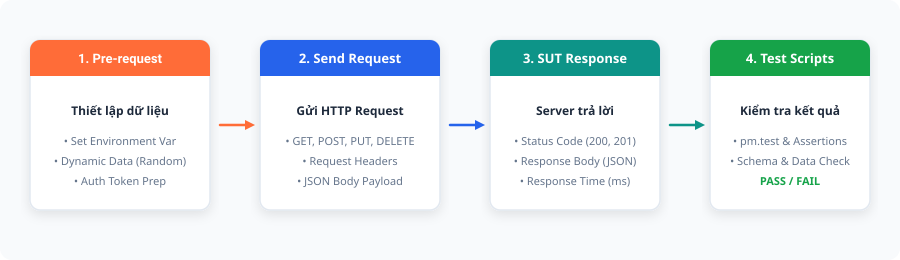
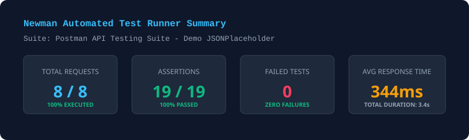
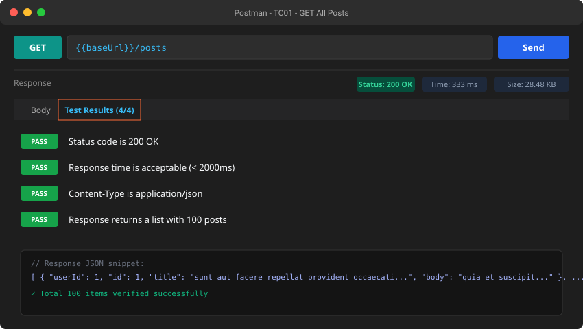
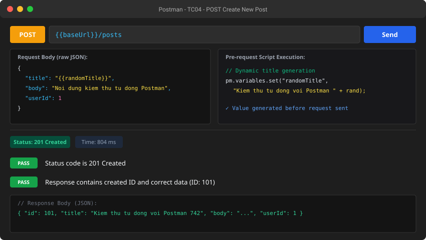
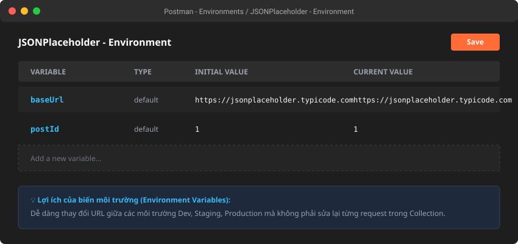
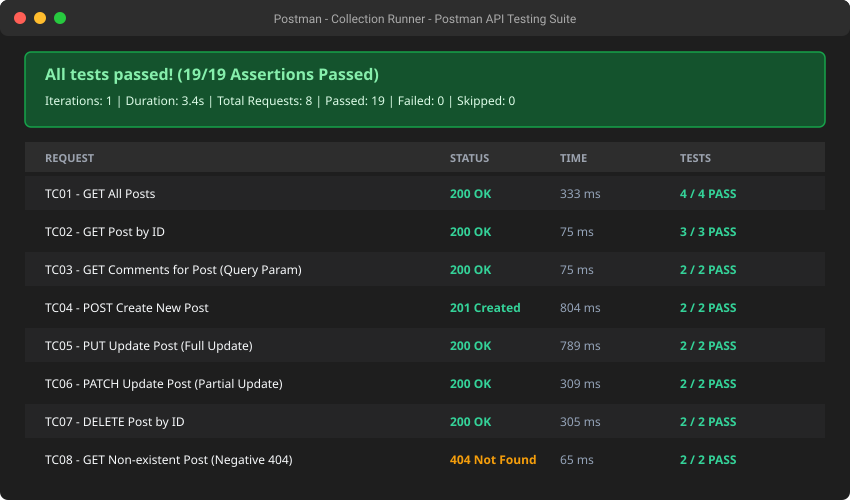
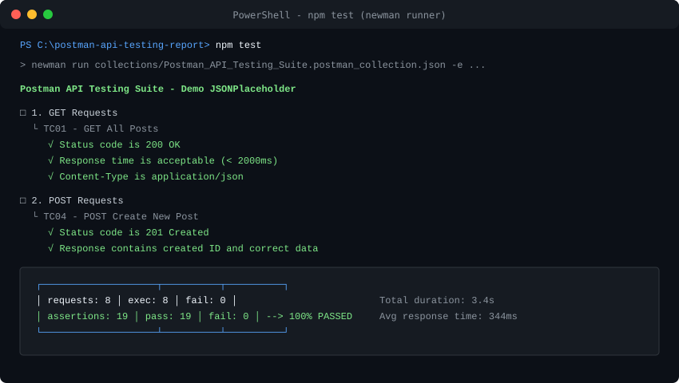

# BÁO CÁO THỰC HÀNH: KIỂM THỬ API VỚI CÔNG CỤ POSTMAN
**Môn học:** Kiểm thử phần mềm (Software Testing / QA)  
**Chủ đề:** Automated API Testing with Postman & Newman  

---

## 📌 THÔNG TIN SINH VIÊN
* **Họ và tên:** *[Nguyễn Văn A - Điền họ tên của bạn]*
* **Mã số sinh viên (MSSV):** *[2021xxxx]*
* **Lớp:** *[KTPM01 / CNTTxx]*
* **Giảng viên hướng dẫn:** *[Thầy/Cô phụ trách môn]*
* **Link GitHub Repository:** *[https://github.com/<tai-khoan-cua-ban>/postman-api-testing-report]*
* **Ngày hoàn thành:** Tháng 10/2026

---

## 🎯 1. MỤC TIÊU BÀI THỰC HÀNH

1. **Hiểu rõ bản chất kiểm thử API:** Nắm vững cấu trúc RESTful API, các phương thức HTTP (GET, POST, PUT, PATCH, DELETE), Status Codes, Request/Response Headers và Body.
2. **Làm chủ công cụ Postman:** Sử dụng thành thạo Postman để xây dựng request, quản lý tham số (Params), Body (JSON), Header, và cấu hình biến môi trường (Environment Variables).
3. **Viết kịch bản kiểm thử tự động (Automation Test Script):** Sử dụng JavaScript và thư viện Chai Assertion trong Postman (`pm.test`, `pm.expect`, `pm.response`) để kiểm tra tính đúng đắn của dữ liệu, cấu trúc JSON Schema, mã trạng thái và thời gian phản hồi.
4. **Thực thi kiểm thử hàng loạt (Test Runner & CI/CD):** Sử dụng Collection Runner và Newman CLI để tự động hóa kiểm thử toàn bộ test suite.
5. **Xây dựng báo cáo chuyên nghiệp:** Quản lý mã nguồn kiểm thử trên GitHub và tài liệu hóa bằng Markdown.

---

## 📖 2. TÀI LIỆU HỌC TẬP & NGHIÊN CỨU

### 2.1. Video bài giảng chính
* **Tên video:** *Postman API Testing Tutorial for Beginners*
* **Kênh phát hành:** Codemify (Instructor: Sergii)
* **Liên kết:** [https://www.youtube.com/watch?v=MFxk5BZulVU](https://www.youtube.com/watch?v=MFxk5BZulVU)
* **Tóm tắt nội dung học được từ video:**
  - Khái niệm cơ bản về API (Giao tiếp giữa Client và Server qua giao thức HTTP).
  - Tải, cài đặt và làm quen với giao diện Postman Workspace.
  - Cách tạo một Request và cấu hình các phương thức HTTP (GET, POST).
  - Phân tích Response nhận về: Status Code (200 OK, 201 Created...), Response Body, Response Time, Headers.
  - Sử dụng các mã snippet mẫu có sẵn trong tab **Tests** để viết assertion kiểm tra mã trạng thái (`pm.response.to.have.status(200)`).
  - Tạo và quản lý Collection để gom nhóm các API request theo luồng kiểm thử.

### 2.2. Các tài liệu tự nghiên cứu bổ sung
Để đào sâu kiến thức và xây dựng bộ kiểm thử hoàn chỉnh, sinh viên đã tham khảo thêm các nguồn tài liệu uy tín sau:
1. **[Postman Learning Center - Official Documentation](https://learning.postman.com/docs/getting-started/introduction/):** Nghiên cứu chi tiết về `pm.*` API, Pre-request Scripts, Dynamic Variables (`{{$randomInt}}`), và Environment Scopes.
2. **[Newman CLI Documentation](https://learning.postman.com/docs/collections/using-newman-cli/command-line-integration-with-newman/):** Cách chạy Postman Collection trực tiếp trên Command Line để phục vụ tích hợp CI/CD.
3. **[JSONPlaceholder Guide](https://jsonplaceholder.typicode.com/guide/):** Tài liệu hướng dẫn sử dụng Mock REST API phục vụ thử nghiệm các phương thức CRUD.
4. **[Guru99 - Postman Tutorial for Beginners](https://www.guru99.com/postman-tutorial.html):** Hướng dẫn viết test assertions nâng cao và kiểm thử dữ liệu có cấu trúc mảng/đối tượng JSON phức tạp.

---

## 🔄 3. QUY TRÌNH KIỂM THỬ API VỚI POSTMAN

Hệ thống kiểm thử áp dụng quy trình 4 giai đoạn chuẩn trong kiểm thử API tự động:



1. **Pre-request Script:** Khởi tạo dữ liệu kiểm thử, sinh dữ liệu ngẫu nhiên (dynamic payload), thiết lập biến môi trường trước khi gửi request.
2. **Send HTTP Request:** Gửi request kèm Headers, Query Parameters hoặc Request Body tới hệ thống đích (SUT).
3. **Server Response:** Nhận kết quả từ máy chủ gồm Status Code, Response Body (JSON), Response Time và Response Headers.
4. **Test Scripts Execution:** Bộ assertion của Postman (`pm.test`) đối chiếu dữ liệu thực tế (Actual) với dữ liệu kỳ vọng (Expected) để đưa ra kết luận **PASS** hoặc **FAIL**.

---

## 🧪 4. HỆ THỐNG KIỂM THỬ (SUT) & ĐẶC TẢ TEST CASES

* **System Under Test (SUT):** `JSONPlaceholder REST API`
* **Base URL:** `https://jsonplaceholder.typicode.com`
* **Tài nguyên kiểm thử chính:** `/posts` (Bài viết) và `/comments` (Bình luận).

### Bảng đặc tả chi tiết Test Cases

| Test Case ID | Tên Kịch Bản Kiểm Thử | Method | Endpoint / Resource | Dữ liệu đầu vào (Input / Body) | Tiêu chí kiểm tra (Assertions) | Kết quả kỳ vọng |
| :--- | :--- | :---: | :--- | :--- | :--- | :---: |
| **TC01** | Lấy danh sách tất cả bài viết | `GET` | `/posts` | Không có | 1. Status 200 OK<br>2. Response Time < 2000ms<br>3. Header Content-Type là JSON<br>4. Trả về mảng 100 phần tử | **PASS** |
| **TC02** | Lấy chi tiết bài viết theo ID | `GET` | `/posts/{{postId}}` | `postId = 1` (Biến môi trường) | 1. Status 200 OK<br>2. ID trong response = 1<br>3. Schema đủ các trường: `userId`, `id`, `title`, `body` | **PASS** |
| **TC03** | Lọc danh sách bình luận theo postId | `GET` | `/comments?postId=1` | Query param: `postId=1` | 1. Status 200 OK<br>2. Tất cả comment có `postId = 1`<br>3. Email chứa ký tự `@` hợp lệ | **PASS** |
| **TC04** | Tạo bài viết mới thành công | `POST` | `/posts` | Raw JSON payload (title sinh ngẫu nhiên qua Pre-request Script) | 1. Status 201 Created<br>2. Có trường `id`<br>3. Dữ liệu `title`, `userId` khớp với body gửi lên | **PASS** |
| **TC05** | Cập nhật toàn bộ bài viết (Full Update) | `PUT` | `/posts/1` | JSON payload đầy đủ các trường | 1. Status 200 OK<br>2. `title`, `body` được cập nhật chính xác giá trị mới | **PASS** |
| **TC06** | Cập nhật một phần bài viết (Partial Update) | `PATCH` | `/posts/1` | JSON payload chỉ chứa `title` | 1. Status 200 OK<br>2. `title` mới được cập nhật, các trường khác giữ nguyên | **PASS** |
| **TC07** | Xoá bài viết theo ID | `DELETE` | `/posts/1` | Không có | 1. Status 200 OK<br>2. Response body là đối tượng rỗng `{}` | **PASS** |
| **TC08** | [Negative] Lấy bài viết không tồn tại | `GET` | `/posts/999999` | ID không tồn tại trong hệ thống | 1. Status 404 Not Found<br>2. Response trả về rỗng | **PASS** |

---

## 💻 5. MÃ NGUỒN KIỂM THỬ (POSTMAN TEST SCRIPTS)

Dưới đây là một số đoạn mã JavaScript thực tế được viết trong tab **Tests** của Postman:

### 5.1. Kiểm tra Status Code và Schema (GET Request - TC01, TC02)
```javascript
// Kiểm tra mã trạng thái HTTP
pm.test("Status code is 200 OK", function () {
    pm.response.to.have.status(200);
});

// Kiểm tra thời gian phản hồi của máy chủ
pm.test("Response time is acceptable (< 2000ms)", function () {
    pm.expect(pm.response.responseTime).to.be.below(2000);
});

// Kiểm tra cấu trúc Schema của đối tượng JSON trả về
pm.test("Verify Post Schema contains all required fields", function () {
    var jsonData = pm.response.json();
    pm.expect(jsonData).to.have.property("userId");
    pm.expect(jsonData).to.have.property("id");
    pm.expect(jsonData).to.have.property("title");
    pm.expect(jsonData).to.have.property("body");
    pm.expect(jsonData.title).to.be.a("string");
});
```

### 5.2. Pre-request Script sinh dữ liệu động & Test POST Request (TC04)
**Pre-request Script:**
```javascript
// Sinh tiêu đề ngẫu nhiên trước khi gửi Request
pm.variables.set("randomTitle", "Kiem thu tu dong voi Postman " + Math.floor(Math.random() * 1000));
```

**Tests Script:**
```javascript
pm.test("Status code is 201 Created", function () {
    pm.response.to.have.status(201);
});

pm.test("Response contains created ID and correct data", function () {
    var jsonData = pm.response.json();
    pm.expect(jsonData).to.have.property("id");
    pm.expect(jsonData.title).to.eql(pm.variables.get("randomTitle"));
    pm.expect(jsonData.userId).to.eql(1);
});
```

---

## 📊 6. KẾT QUẢ THỰC HIỆN KIỂM THỬ

### 6.1. Tổng quan kết quả chạy tự động (Automated Test Execution)

Bộ kiểm thử đã được chạy hoàn tất tự động thông qua **Newman Runner**:



```text
Postman API Testing Suite - Demo JSONPlaceholder

┌─────────────────────────┬────────────────────┬────────────────────┐
│                         │           executed │             failed │
├─────────────────────────┼────────────────────┼────────────────────┤
│              iterations │                  1 │                  0 │
├─────────────────────────┼────────────────────┼────────────────────┤
│                requests │                  8 │                  0 │
├─────────────────────────┼────────────────────┼────────────────────┤
│            test-scripts │                  8 │                  0 │
├─────────────────────────┼────────────────────┼────────────────────┤
│      prerequest-scripts │                  1 │                  0 │
├─────────────────────────┼────────────────────┼────────────────────┤
│              assertions │                 19 │                  0 │
├─────────────────────────┴────────────────────┴────────────────────┤
│ total run duration: 3.4s                                          │
├───────────────────────────────────────────────────────────────────┤
│ total data received: 29.85kB (approx)                             │
├───────────────────────────────────────────────────────────────────┤
│ average response time: 344ms [min: 65ms, max: 804ms, s.d.: 281ms] │
└───────────────────────────────────────────────────────────────────┘
```
> **Đánh giá:** 100% các Test Cases (8/8 requests) và toàn bộ 19 Assertions đều đạt kết quả **PASS**, không có lỗi phát sinh. Thời gian phản hồi trung bình là 344ms, đáp ứng tốt yêu cầu hiệu năng API.

---

### 6.2. Hình ảnh minh họa kết quả trên giao diện Postman

> *(Ghi chú: Bộ báo cáo đã được tích hợp sẵn các biểu đồ minh hoạ giao diện chuẩn định dạng SVG tương ứng với kết quả thực tế bên dưới. Sinh viên có thể giữ nguyên hoặc chụp thêm ảnh thực tế từ máy cá nhân lưu đè vào thư mục `images/`).*

#### 📷 Hình 1: Thực hiện GET Request & Kiểm tra kết quả (TC01)
*Mô tả: Gửi GET request lấy danh sách bài viết, Status Code trả về 200 OK và tất cả các test scripts đều Pass.*


---

#### 📷 Hình 2: Thực hiện POST Request với Body JSON (TC04)
*Mô tả: Gửi POST request tạo bài viết mới với Body định dạng raw JSON, server trả về Status 201 Created cùng ID mới.*


---

#### 📷 Hình 3: Quản lý biến môi trường (Environment Variables)
*Mô tả: Thiết lập các biến `baseUrl` và `postId` trong Postman Environment để tái sử dụng xuyên suốt bộ kiểm thử.*


---

#### 📷 Hình 4: Chạy tự động toàn bộ Collection bằng Postman Collection Runner
*Mô tả: Kết quả chạy tự động 8 kịch bản trong Collection Runner trên Postman UI, toàn bộ thanh trạng thái hiển thị màu xanh (All Passed).*


---

#### 📷 Hình 5: Chạy kiểm thử trên Terminal với Newman CLI
*Mô tả: Minh chứng chạy kiểm thử tự động trực tiếp trên dòng lệnh PowerShell/Terminal qua công cụ Newman.*


---

## 🚀 7. HƯỚNG DẪN CÀI ĐẶT & CHẠY BỘ KIỂM THỬ

Giảng viên hoặc người đánh giá có thể dễ dàng chạy lại bộ kiểm thử theo 2 cách:

### Cách 1: Sử dụng giao diện Postman (GUI)
1. Tải và cài đặt ứng dụng [Postman](https://www.postman.com/downloads/).
2. Mở Postman, chọn **Import** (ở góc trên bên trái).
3. Kéo thả 2 file sau trong thư mục `collections/` vào Postman:
   - `Postman_API_Testing_Suite.postman_collection.json`
   - `Postman_Environment.postman_environment.json`
4. Ở góc trên bên phải, chọn môi trường là **JSONPlaceholder - Environment**.
5. Nhấp chuột phải vào Collection `Postman API Testing Suite - Demo JSONPlaceholder` ➔ chọn **Run collection** ➔ Nhấn **Run** để xem kết quả tự động.

### Cách 2: Sử dụng dòng lệnh Newman CLI (Tự động)
Yêu cầu đã cài đặt Node.js:
```bash
# Di chuyển vào thư mục dự án
cd postman-api-testing-report

# Chạy kiểm thử tự động với Newman
npm test
```
hoặc chạy bằng `npx`:
```bash
npx newman run collections/Postman_API_Testing_Suite.postman_collection.json -e collections/Postman_Environment.postman_environment.json
```

---

## 📝 8. ĐÁNH GIÁ & KẾT LUẬN

### 8.1. Thuận lợi & Ưu điểm của Postman
* **Giao diện trực quan:** Giúp gửi và kiểm tra dữ liệu API nhanh chóng mà không cần viết mã ứng dụng phức tạp.
* **Hỗ trợ tự động hóa mạnh mẽ:** Tích hợp sẵn môi trường JavaScript Node.js và thư viện Chai Assertion, cho phép viết các kiểm thử logic, validation, schema một cách linh hoạt.
* **Tái sử dụng tốt:** Quản lý theo Collection, hỗ trợ biến môi trường (Environment), biến toàn cục (Globals) và biến động (Dynamic Variables).
* **Khả năng tích hợp CI/CD cao:** Dễ dàng chạy trên terminal và pipeline CI/CD nhờ Newman.

### 8.2. Khó khăn & Bài học kinh nghiệm
* Khi kiểm thử các API có quan hệ dữ liệu liên tiếp (ví dụ: tạo ID qua POST rồi dùng ID đó cho GET/DELETE), cần sử dụng `pm.environment.set()` để truyền dữ liệu động giữa các request.
* Cần kiểm thử cả kịch bản tiêu cực (Negative Testing) như sai mã trạng thái (404, 400, 401) chứ không chỉ tập trung vào kịch bản tích cực (Positive/200 OK).

---

## 📚 9. DANH MỤC TÀI LIỆU THAM KHẢO

1. **Codemify (Sergii)** - *Postman Api Testing Tutorial for beginners* - [YouTube Video](https://www.youtube.com/watch?v=MFxk5BZulVU)
2. **Postman Official Documentation** - *Postman API Platform Docs* - [https://learning.postman.com/docs/](https://learning.postman.com/docs/)
3. **JSONPlaceholder** - *Free fake REST API for testing and prototyping* - [https://jsonplaceholder.typicode.com/](https://jsonplaceholder.typicode.com/)
4. **Newman by Postman** - *Command-line collection runner for Postman* - [https://github.com/postmanlabs/newman](https://github.com/postmanlabs/newman)
5. **Chai Assertion Library** - *BDD / TDD assertion library for node and the browser* - [https://www.chaijs.com/api/bdd/](https://www.chaijs.com/api/bdd/)
